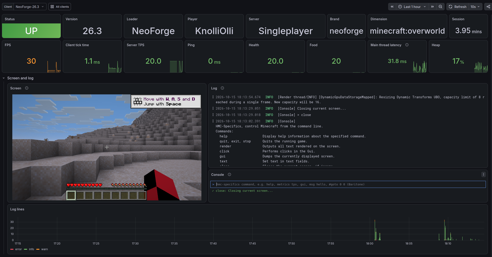
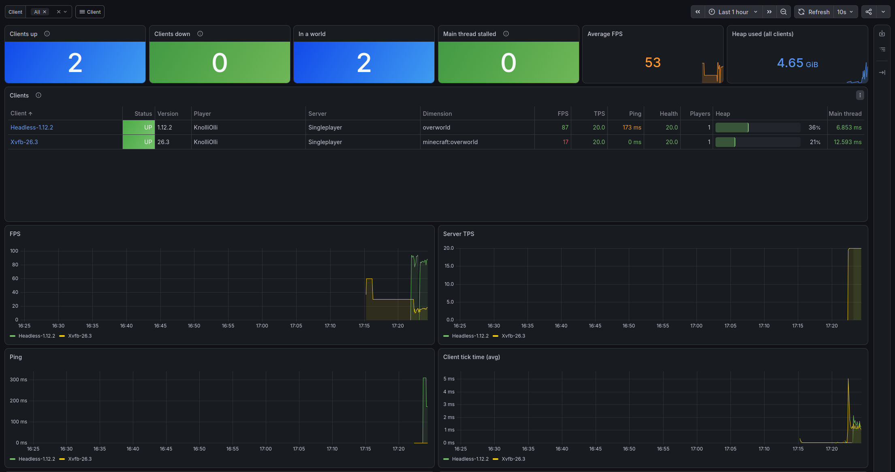
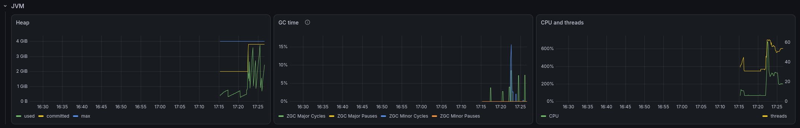

<h1 align="center" style="font-weight: normal;"><b>hmc-prometheus</b></h1>

A prometheus exporter for the Minecraft client.

<a href="https://github.com/headlesshq/headlessmc">HeadlessMc</a> | <a href="https://github.com/headlesshq/hmc-specifics">hmc-specifics</a> | <a href="https://github.com/headlesshq/hmc-optimizations">hmc-optimizations</a>

A [Prometheus](https://prometheus.io) exporter for the Minecraft client, powered
by [hmc-specifics](https://github.com/headlesshq/hmc-specifics)
and [HeadlessMc](https://github.com/headlesshq/headlessmc).
It exports all kinds of metrics
(FPS, server TPS, ping, players, position, health, ...) together with JVM metrics,
so that you can watch all of your running clients in Grafana.
It can also push the game log to [Loki](https://grafana.com/oss/loki/), with chat colors,
and serve screenshots of the game.
It supports all mc versions that hmc-specifics also supports.
See [example](example) for a Prometheus and Grafana setup with dashboards.

## Setup

Place the hmc-specifics mod for your mc version and platform and the hmc-prometheus jar inside your mods folder.
You can follow the docker-compose.yml in [example](example) to setup a grafana instance with a pre-configured 
dashboard for hmc-prometheus.

## Configuration

The config is written to `config/hmc-prometheus.properties` in the game directory when the game starts.
Every option can also be set with a system property, e.g. `-Dhmc.prometheus.client=bot-1`,
which is useful when you launch many instances from scripts.

| Option                 | Default                                | Description                                                                       |
|------------------------|----------------------------------------|-----------------------------------------------------------------------------------|
| `enabled`              | `true`                                 | Start the exporter with the game.                                                 |
| `client`               | account name                           | Value of the `client` label, identifies this client in Grafana.                   |
| `host`                 | `127.0.0.1`                            | Address to bind to. Use `0.0.0.0` if Prometheus runs on another machine.          |
| `port`                 | `9400`                                 | First port to try.                                                                |
| `portRange`            | `100`                                  | How many following ports to try, if the port is in use.                           |
| `include`              | (all)                                  | HMC-Specifics metrics to export, by name, group or last part, comma separated.    |
| `exclude`              | `jvm`                                  | Metrics not to export. The `jvm` group is covered by the Prometheus JVM metrics.  |
| `jvmMetrics`           | `true`                                 | Export the JVM metrics of the Prometheus Java client.                             |
| `collectTimeoutMs`     | `2000`                                 | How long a scrape waits for the main thread.                                      |
| `discoveryDir`         | `${user.home}/.hmc-prometheus/targets` | Directory for the Prometheus discovery files, empty to disable.                   |
| `discoveryAddress`     | `host`                                 | Address written to the discovery file, e.g. `host.docker.internal`.               |
| `grafanaUrl`           | `http://localhost:3000`                | Used by the `prometheus` command to print a link to the dashboard of this client. |
| `lokiUrl`              | (disabled)                             | Base URL of Loki to push the game log to, e.g. `http://127.0.0.1:3100`.           |
| `lokiBackfill`         | `true`                                 | Also push the lines of `logs/latest.log` from before HMC-Prometheus started.      |
| `screenshots`          | `true`                                 | Serve screenshots on `/screenshot.png` and `/live`.                               |
| `screenshotIntervalMs` | `1000`                                 | Minimum time between two screenshots.                                             |
| `console`              | `false`                                | Allow executing hmc-specifics commands from the web console on `/console`.        |

Pushing the log is opt-in, because the log contains chat and server addresses:
`prometheus set lokiUrl http://127.0.0.1:3100`.
The web console is opt-in too, because anyone who can reach the client can then control the game:
`prometheus set console true`.

## Screenshots
It also allows you to manage multiple clients at the same time:

## Metrics

Every metric of the hmc-Specifics `MetricsService` is converted automatically, including custom metrics from other mods:

| HMC-Specifics value                  | Prometheus                                                                      |
|--------------------------------------|---------------------------------------------------------------------------------|
| Number, e.g. `server.tps`            | gauge `hmc_server_tps`                                                          |
| Boolean, e.g. `server.connected`     | gauge `hmc_server_connected` with 0 or 1                                        |
| String, e.g. `server.brand`          | `hmc_server_brand_info{value="Paper"} 1`                                        |
| Map, e.g. `client.mspt = {avg, max}` | `hmc_client_mspt_avg`, `hmc_client_mspt_max`                                    |
| List of maps, e.g. `players.list`    | `hmc_players_list_ping{name="...", uuid="...", gamemode="..."}`, one per player |
| `null`, e.g. not in a world          | left out                                                                        |

Units are the ones of HMC-Specifics, e.g. `hmc_server_ping` and `hmc_client_mspt_avg` are milliseconds.
Use `metrics --list` in HMC-Specifics to see all metrics. HMC-Prometheus adds:

| Metric                                                                                                               | Description                                                                                                 |
|----------------------------------------------------------------------------------------------------------------------|-------------------------------------------------------------------------------------------------------------|
| `hmc_prometheus_info{loader, version}`                                                                               | The modloader and the version of HMC-Prometheus.                                                            |
| `hmc_collect_success`                                                                                                | 1 if the main thread collected the metrics in time.                                                         |
| `hmc_main_thread_latency_seconds`                                                                                    | Time until the main thread started collecting, shows how responsive the game is.                            |
| `hmc_collect_duration_seconds`                                                                                       | Time the collection took on the main thread.                                                                |
| `hmc_data_age_seconds`                                                                                               | Age of the served values, greater than 0 if old values had to be served.                                    |
| `hmc_screenshots_available`                                                                                          | 1 if `/screenshot.png` and `/live` serve screenshots.                                                       |
| `hmc_loki_sent_lines_total`, `hmc_loki_dropped_lines_total`, `hmc_loki_failed_pushes_total`, `hmc_loki_queued_lines` | State of the log push, if `lokiUrl` is set.                                                                 |
| `jvm_*`, `process_*`                                                                                                 | JVM metrics of the [Prometheus Java client](https://prometheus.github.io/client_java/instrumentation/jvm/). |

## Commands

The commands are registered in the HMC-Specifics command line:

| Command                             | Description                                                                                         |
|-------------------------------------|-----------------------------------------------------------------------------------------------------|
| `prometheus`                        | Status: client name, metrics URL, discovery file, live view, Loki and a Grafana link.               |
| `prometheus start` / `stop`         | Starts (or restarts) / stops the exporter. Stopping removes the client from discovery.              |
| `prometheus reload`                 | Reads the config file again and restarts the exporter.                                              |
| `prometheus config`                 | Lists all options and their current values.                                                         |
| `prometheus set <option> [<value>]` | Changes an option in the config file and restarts the exporter, e.g. `prometheus set client bot-1`. |
